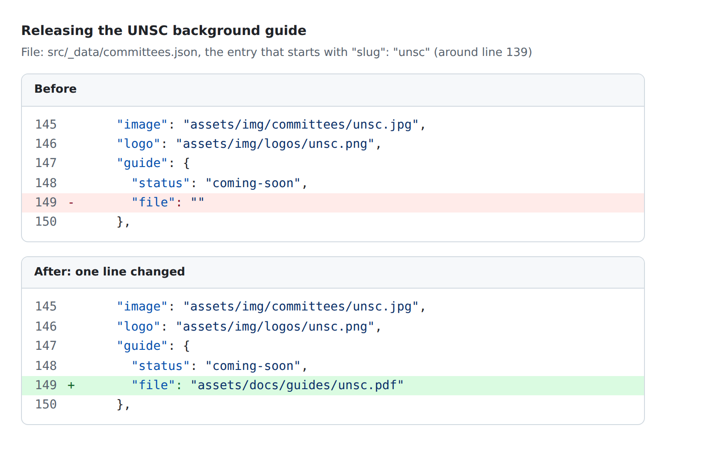
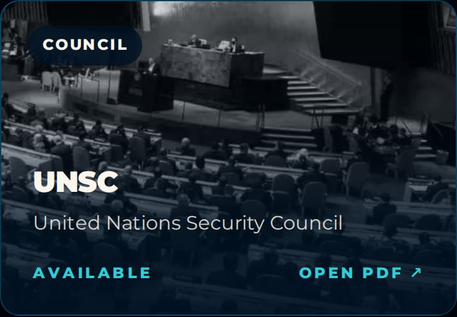
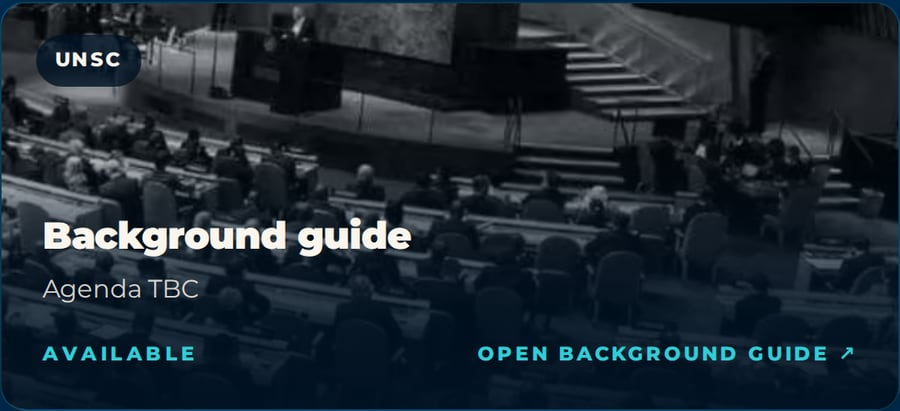

# Updating the website

You don't need to know how to code to update the site. Every name, date, agenda and link lives in a small set of text files, and you can edit them on GitHub's website from a computer or a phone. When you save, the site rebuilds and the change is live about two minutes later ([DEPLOY.md](DEPLOY.md) explains how).

If you make a mistake, the build stops before anything is uploaded, so the live site stays as it was, and the message tells you which file and line to fix.

## Where things live

All the content is in `src/_data/`:

| File | What's in it |
| --- | --- |
| `site.json` | The conference name, dates and venue; the announcement bar; the Register link; the contact email; homepage text; the theme; the Secretary-General's letter; sponsors; allocation rounds; the short intros on each page |
| `committees.json` | Every committee: code, full name, agenda, overview, photo, logo, background guide, and its executive board (EB); for IP, its team |
| `secretariat.json` | The Secretariat: names, roles, photos, quotes, Instagram posts and handles |
| `schedule.json` | Both days of the conference |
| `faq.json` | The questions and answers on the homepage |
| `resources.json` | Procedure documents, the International Press style guides and research links |
| `socialNight.json` | The Social Night page |
| `newToMun.json` | The New to MUN? page |

Photos and PDFs live in `src/assets/`:

| Folder | What goes in it |
| --- | --- |
| `src/assets/docs/guides/` | Background guide PDFs |
| `src/assets/docs/` | Other PDFs (Rules of Procedure, Delegate Guidelines and so on) |
| `src/assets/img/committees/` | One photo per committee. Colour is fine; it's made black and white automatically. |
| `src/assets/img/logos/` | Committee logo circles (PNG) |
| `src/assets/img/eb/` | Chair, Vice Chair and Rapporteur photos |
| `src/assets/img/secretariat/` | Secretariat photos and the Secretary-General's signature |
| `src/assets/img/sponsors/` | Sponsor logos (SVG, PNG or JPG) |

Name files in lower case with hyphens and no spaces, for example `unsc-chair.jpg`. In the data files, a path starts at `assets/`, without `src/`. For example, the file `src/assets/img/eb/unsc-chair.jpg` is written as `"assets/img/eb/unsc-chair.jpg"`.

## How to edit a file on GitHub

1. Go to github.com/suprathedude/jmun-26-wesbite and sign in.
2. Click `src`, then `_data`, then the file you want.
3. Click the pencil icon ("Edit this file"). On a phone, it's at the top right of the file. If you don't see it, tap the `...` menu and choose **Edit file**.
4. Make your change.
5. Click **Commit changes...**, write a short note such as "Release UNSC guide", leave **Commit directly to the main branch** selected, and click **Commit changes**.
6. Open the **Actions** tab. A yellow dot means it's building. A green tick about two minutes later means it's live.

**To upload a photo or PDF:** open the folder, click **Add file → Upload files**, choose the file, then **Commit changes**.

### Rules for the data files

The files are JSON. It looks fussy, but there are only a few rules:

- Text goes in straight double quotes: `"name": "Aryan Nadimpalli"`. Don't use a double quote inside the text; an apostrophe (`'`) is fine.
- Items are separated by commas. The last item before a `}` or `]` has no comma after it.
- Only change what's to the right of the colon. The names on the left (`"name"`, `"photo"`) must stay exactly as they are.
- `""` means "not set yet". Something that will exist but isn't decided yet says `TBC`, so it can be found later by searching for TBC.
- Write in British English, keep sentences short, and don't use long dashes (—).

### If the build fails

Open the red run in the Actions tab and click the step with the red cross. The message names the file and the problem. The common ones:

| Message | What it means |
| --- | --- |
| `src/_data/site.json has a typo near line 26, column 5: Expected ',' or '}' after property value.` | A comma is missing at the end of the line before line 26, or there's an extra one before a `}`. The message shows the line. |
| `committees.json, committee 4 (UNHRC), EB member 1: there's no photo at src/assets/img/eb/unhrc-chair.jpg.` | The path in the file doesn't match an uploaded file. Check the spelling and the folder, or upload the file. |
| `secretariat.json, person 3 (Raaghav Modukuri): group "leaders" must be one of "leadership", "usg".` | Use one of the listed values exactly. |
| `schedule.json, day 1, event 3 (Break): type "breaks" must be one of "committee", "ceremony", "social", "meal", "break", "end".` | Same: use a listed value. |
| `resources.json, researchLinks 2 (UN Research Guides): the url must start with https://` | Links to other websites need the full address. |

Fix the file and commit again. Nothing went live while it was broken.

---

## Worked example: releasing a background guide

This releases the UNSC guide. Every other committee works the same way.

**1. Upload the PDF.** Open `src/assets/docs/guides/`, click **Add file → Upload files**, and upload the guide named after the committee's `slug`: `unsc.pdf`.

**2. Point the committee at it.** Open `src/_data/committees.json` and find the entry that starts with `"slug": "unsc"`. In its `"guide"` part, change `"file": ""` to the PDF's path. That's the only line that changes; `"status"` can stay as it is.



**3. Commit, then wait for the green tick.** Both the Resources page and the UNSC page switch from "Coming soon" to "Available", with a link that opens the PDF in a new tab.

Before, on Resources:


After, on Resources:



After, on the UNSC committee page:



The **essential documents** (Rules of Procedure, Delegate Guidelines, Consent Form) and the two **International Press style guides** (IP Journalism, IP Photography) work the same way. Upload the PDF to `src/assets/docs/`, then set its `"file"` in `src/_data/resources.json` (the style guides are under `"ipGuides"`), for example `"file": "assets/docs/rules-of-procedure.pdf"`. The card changes from "Coming soon" to "PDF".

---

## Add an EB member

Open `committees.json` and find the committee. Its `"eb"` list has three people: Chair, Vice Chair and Rapporteur. Fill in their details:

```json
{
  "role": "Chair",
  "name": "Ananya R.",
  "photo": "assets/img/eb/unsc-chair.jpg",
  "bio": "Two or three sentences about them, written for 11-year-olds."
}
```

- Upload the photo to `src/assets/img/eb/` first. It's shown square, so put the face near the middle. Leave `"photo": ""` and the card shows "Photo TBC".
- While `"name"` is `""`, the card reads "EB announced soon".
- Long bios are cut to two lines with a "Read more" button.
- To add a fourth person, copy a whole `{ ... }` block, paste it after the last one, and put a comma between the two blocks.

## Add the IP team

International Press has no agenda and no EB. Its entry in `committees.json` has `"press": true`, which shows the two style guides and a team section instead. The team is in its `"team"` list, filled in like an EB member:

```json
{
  "role": "Editor-in-Chief",
  "name": "Full Name",
  "photo": "assets/img/eb/ip-editor.jpg",
  "bio": "Two or three sentences."
}
```

- While `"name"` is `""`, the card reads "Name TBC"; without a photo it shows "Photo TBC".
- Bios are cut to four lines with a "Read more" button.
- `"teamTitle"` is the section's heading ("IP team").
- The style guides' text and PDFs are in `resources.json` → `"ipGuides"` (see Resources).

## Change the gallery photos (homepage intro)

On the first homepage visit of a session, photos fly out of the dark before the hero. They're listed in `site.json`:

```json
"gallery": {
  "screens": 2.5,
  "cue": "Scroll",
  "images": [
    "assets/img/gallery/unsc.webp",
    "assets/img/gallery/disec.webp"
  ]
},
```

- Upload photos to `src/assets/img/gallery/` and list their paths in `"images"`. 10 to 15 photos works well; up to 15 are on screen at once, each photo once. Use landscape or portrait, about 1000 px on the long side, as `.webp` or `.jpg` (keep each under about 100 KB, since they all load at the start).
- `"screens"`: how many screens of scrolling it takes to reach the hero.
- `"cue"`: the small word at the bottom of the screen.
- People who have turned off animations on their device, and later visits in the same session, start at the hero.

## Change the pop-ups

The boxes that open over the homepage after it loads (since 14 October). Since 16 October there
can be several: the first opens, and each of the others opens as the one before it is closed.
In `site.json` → `notice`:

- `"popups"`: the list, in the order they open. Each one is either news or a single line.
  - **News:** `"title"` and `"text"` (a sentence or two); an optional `"flash"`, the most urgent
    line in a highlighted box at the top (`title`, optional `text`, optional `link` with `label`
    and `url`, for example the Teams joining link); `"lists"`, one or more lists of dates, each
    under its own `"title"`; and `"link"`, the main button (leave `"url": ""` for none), or
    instead `"register": true` for the Register button with its menu of forms, the same as in the
    hero (18 October: the extended registration dates are a pop-up of their own with it, after
    the allocations and training one, so the training links are near the top). A list has either
    `"trainingDates": true` (the training sessions from `newToMun.json`, so a changed date only
    needs changing there) or `"dates"` (a list of `label` and `date`, and an optional `detail`,
    a smaller line under the label such as `"Grades 9 to 12"`), or both; and an optional `"note"`
    under it (`text`, and a `link` with `label` and `url`, now pointing to the training
    recordings on Resources, `/resources/#training`). For example:

    ```json
    {
      "title": "Registration has been extended",
      "lists": [
        {
          "title": "New closing dates",
          "dates": [
            { "label": "Delegates", "detail": "Grades 6 to 8", "date": "Wednesday 28 October" }
          ]
        }
      ],
      "register": true
    }
    ```

    and, in the first pop-up:

    ```json
    "lists": [
      {
        "title": "Training sessions on Microsoft Teams",
        "trainingDates": true,
        "note": { "text": "Missed a training session?", "link": { "label": "Find the recordings and slides here!", "url": "/resources/#training" } }
      }
    ]
    ```

    A closing date that has passed: add `"done": true` to it and it's crossed out, or delete it.

    Each list makes the pop-up longer. On phones it scrolls, so take a list out once it's no
    longer news. While a pop-up runs past the bottom of the screen, a small button at its foot
    says so (`"more"` in `notice`, "Scroll for more") and scrolls it on when tapped; it goes once
    the end of the pop-up is in sight.
  - **A single line:** `"headline"`, shown in capitals, `"highlight"`, the words in it to pick
    out in teal (copied exactly from the headline), and an optional `"link"` button (the lead-in
    one goes to New to MUN's lead-in section, `/new-to-mun/#lead-in`).
- `"pages"`: where they open (`["/"]` is the homepage only). Leave it out to show them on every page.
- `"everyVisit": true` opens them once per visit (22 October): the first time someone reaches the
  page, and not again when they come back to it in the same visit. A new tab or a reopened browser
  is a new visit. Without it, they open once per browser, and again only when their text changes.
  Either way, changed text shows again.
- `"enabled": false` turns them all off. To drop one, delete it from the list.

Following a pop-up's button (See allocations) leaves the page, so the ones after it wait for the
next visit. The Register menu's forms open in a new tab, so the pop-ups carry on.

## Change the announcement bar

In `site.json`:

```json
"announcement": {
  "enabled": true,
  "items": [
    { "text": "Registrations are open!", "link": "https://forms.cloud.microsoft/..." },
    { "text": "Allocation Round 1 is out!", "link": "/allocations/" }
  ]
},
```

- `"items"`: one message, or several that take turns every 4.5 seconds (hovering or focusing the bar holds the current one). Keep each short: it's shown in capitals across the top of every page, and on one line on phones.
- `"link"`: optional. Use a page of this site (`/allocations/`) or a full address (`https://...`, which opens in a new tab). Leave it `""` for no link.
- `"flash": true`: a pulsing dot before that message, for urgent news.
- `"enabled": false` hides the bar.
- Visitors who closed the bar see it again as soon as any message changes.

## Edit the schedule

In `schedule.json`, each day has a list of `"events"`. Each event looks like this:

```json
{
  "start": "9:30 am",
  "end": "11:00 am",
  "title": "Committee session 1",
  "type": "committee"
}
```

- `"start"` and `"end"`: write times like `8:00 am` or `1:30 pm`. The length shown under the title ("1 hour 30 minutes") is worked out for you. For the last event of a day, leave `"end": ""` and it reads "7:00 pm onwards".
- `"type"` is one of `committee`, `ceremony`, `social`, `meal`, `break` or `end`. It isn't shown on the page.
- Optional: `"link"`, a page the event's title links to, for example `"/social-night/"`.
- To change the order, move whole `{ ... }` blocks. Mind the commas.
- Each day has a `"label"` (`"Day one"`), a `"dateLabel"` (`"Friday 30 October"`) and a `"tab"`, the short text on its tab above the timetable (`"30 Oct · Day 1"`). Keep tabs short so both fit side by side on a phone.
- The "Share timetable" button draws both days into one picture from the timetable itself, so it updates by itself. Its button text and file name are in `"share"`.
- `"title"` is the section's heading ("Conference Schedule"), also used on the shared image.
- `"note"` at the top shows next to the schedule title (under it on phones). Update it when the times are final, or set it to `""` to hide it.

## Edit the Secretariat

Each person in `secretariat.json` looks like this:

```json
{
  "name": "Aryan Nadimpalli",
  "role": "Deputy Secretary-General",
  "group": "leadership",
  "photo": "assets/img/secretariat/aryan-nadimpalli.jpg",
  "photoLabelled": true,
  "quote": "",
  "post": "",
  "signature": "",
  "instagram": ""
}
```

- `"group"`: `leadership` for the top six, `usg` for the Under-Secretaries-General. Everyone shows in one even grid, in the order of the file.
- `"photo"`: upload it to `src/assets/img/secretariat/` first. It's shown tall (4:5), so keep the face in the top half. While it's `""`, the card shows initials.
- `"photoLabelled"`: `true` when the photo already shows the name and role (the Secretariat's own posts), so the card doesn't print them over it. `false` for a plain photo.
- `"quote"`: a short quote for the back of the card, without quotation marks (the card adds them). Leave it `""` for none.
- `"post"`: the link to the person's Instagram post. The back's button then says "View post" and opens it; while it's `""`, the button says "View on Instagram" and opens the conference's account.
- `"instagram"`: the person's own handle, with or without `@`, shown under their role on the back. Optional.
- To add someone, copy a whole `{ ... }` block, paste it where they should appear, and mind the commas.

## Turn the theme on

In `site.json`:

```json
"theme": {
  "enabled": true,
  "words": ["Word", "Word", "Word"],
  "highlight": 2,
  "caption": "One sentence about the theme."
},
```

- `"words"`: the theme, a few words long.
- `"highlight"`: which word is shown in teal, counting from 1.
- While `"enabled"` is `false`, the homepage shows "Conference theme announced soon" instead.

## Add a sponsor

1. Upload the logo to `src/assets/img/sponsors/`, ideally as an SVG (sharp at every size), otherwise a PNG or JPG at least 400 pixels wide (for example `acme.svg`).
2. In `site.json`, add the sponsor to `"sponsors"`:

```json
"sponsors": [
  { "name": "Car Kia", "logo": "assets/img/sponsors/car-kia.png", "url": "https://carkia.in", "white": true },
  { "name": "Acme Ltd", "logo": "assets/img/sponsors/acme.svg", "url": "https://acme.example", "white": false }
],
```

- Sponsors show in the footer of every page, under `footer` → `sponsorsLabel` ("Sponsored by").
- `"white": true` shows the logo in plain white, which suits a one-colour logo on the navy footer. Use `false` for a logo with several colours.
- `"url"` is optional; use `""` for none, or the sponsor's website to make the logo a link.
- `site.json` → `home` → `showSponsors`: `true` also shows an "Our sponsors" strip at the bottom of the homepage.

## Add or remove a committee

**To add one,** copy a whole committee block in `committees.json` (from its `{` to its `}`), paste it where it should appear in the list, and put a comma between it and its neighbours. Then change:

| Field | What to put |
| --- | --- |
| `"slug"` | Lower case letters, numbers and hyphens. It becomes the address: `"un-women"` → `/committees/un-women/`. It must not match another committee. |
| `"code"` | The short name, shown huge: `"UN Women"` |
| `"name"` | The full name |
| `"agenda"` | `"Agenda TBC"` until it's announced |
| `"overview"` | Two or three plain sentences |
| `"image"` | `"assets/img/committees/un-women.jpg"` after uploading the photo, or `""` for "Photo TBC". The same photo is used on the committee's card in the homepage ring. |
| `"imagePosition"` | Optional. Which part of a tall or wide photo to keep in view, across then down: `"50% 85%"` keeps the lower part (used for Doomsday). Leave it out to centre the photo. |
| `"logo"` | `"assets/img/logos/un-women.png"` after uploading the logo circle, or `""` for a globe icon |
| `"guide"` | `{ "status": "coming-soon", "file": "" }` |
| `"eb"` | The three EB entries, with `"name": ""` until they're announced |

Everything else updates by itself:
- the tile on the Committees page;
- the committee's own page;
- its guide card on Resources;
- the committee names scrolling across the homepage and the ring of committee cards;
- every committee count ("Twelve committees" becomes "Thirteen").

**To remove one,** delete its whole block from `{` to `}`, and the comma that went with it. You can delete its photo and logo too, but you don't have to.

---

## Other things you might change

| To change | Where |
| --- | --- |
| The Resources section titles and the line under each | `site.json` → `resourcesPage` → `sections` |
| The Get QR page's text and messages, and the PDF pass's words (`pdf`); how QR passes and desk check-in work is in `docs/QR.md` | `site.json` → `qrPage` |
| **Turning QR passes on** (only when the Secretariat says go) | `site.json` → `qrPage` → `"open": true`. While it's `false`, the QR page says `closedNote` and gives out nothing. The check-in app must be connected and its admin switch on too: `docs/QR.md`, "Turning QR passes on". |
| The Entry QR button in the nav (between More and Register) | `site.json` → `nav.qr`: `label` in the nav (keep it short, or the nav runs out of room), `sheetLabel` in the phone menu |
| The Register button and its dropdown (nav, homepage hero, homepage closing banner and the New to MUN page): delegate registration, and applications to International Press and the Organising Committee | `site.json` → `nav` → `register` (17 October): `label` on the button, `sheetTitle` above the three buttons in the phone menu, and one entry per form in `options` (`title`, the small `tag` under it, `button` for the International Press button on the IP committee page, and the form's `url`). An entry with `"url": ""` shows as "link TBC". |
| The "Consent form" button (hidden until it has a link) | `site.json` → `nav` → `secondary` → `url` |
| The contact email | `site.json` → `contact` → `email`, and the last answer in `faq.json` (with its button's `mailto:` link) |
| The conference dates | `site.json` → `start` and `end`, written like `2026-10-30T08:00:00+05:30`. The countdown and every date on the site follow these. |
| The Secretary-General's letter | `site.json` → `sgLetter`: `paragraphs` (one item per paragraph), `closing` (the line above the name), `photo`, `signature` |
| Allocation rounds and the matrix link | `site.json` → `allocations`: `rounds` (`name`, `date`, `note`), `status`, `matrixUrl` |
| FAQ answers | `faq.json`. An answer can have a button: `"link": { "label": "See allocations", "url": "/allocations/" }` |
| Social Night details | `socialNight.json`: `time`, `dressCode`, `expect`, `faq`. The photo booth section (`photoBoothTitle`, `photoBooth`) shows "Photo TBC" until `photoBoothImage` is set. |
| The lead-in session on New to MUN | `newToMun.json` → `leadIn`: the `intro`, and three cards (`panels`), each with a `title`, a Lucide `icon` and its `items`. Put the time and the joining link in the "When and where" card once they're known (they say TBC now). |
| Training sessions (New to MUN, and Resources → 04 Training Sessions) | `newToMun.json` → `training.sessions`: each session's `date`, its Teams joining `link` (the New to MUN card says "Join on Microsoft Teams"), its `recording` link once it's up (the card then says "Watch the recording" instead), and its `slides`. Both pages read the same list. `recording` and `slides` can be a web address (a OneDrive or SharePoint share link, for example) or a file you put in `src/assets/docs/`, written as `assets/docs/the-file-name.pdf`. Save slides as PDF if you can (File > Export > PDF in PowerPoint): a PDF opens on any phone, a `.pptx` only downloads. Until then each card says "Recording coming later" and "Slides coming later". Once a session is over, set its `"done": true`: it's crossed out in the homepage pop-up's list of dates, and you can empty its joining `link`. Joining links on the site are public: anyone with one can ask to join, so keep the Teams lobby on and let a host admit people. |
| Research links | `resources.json` → `researchLinks`: `title`, `url` (must start with `https://`), `description` |
| The hero photo or video | See [REPLACE_ME.md](REPLACE_ME.md), "Hero background" |

[REPLACE_ME.md](REPLACE_ME.md) lists every TBC on the site and what should replace it.
